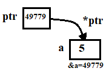
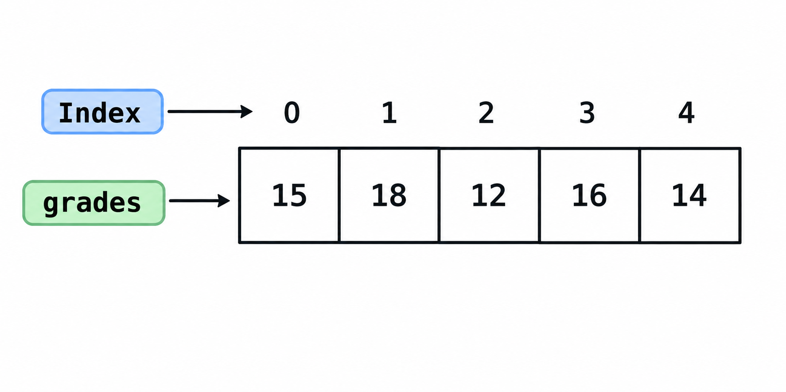
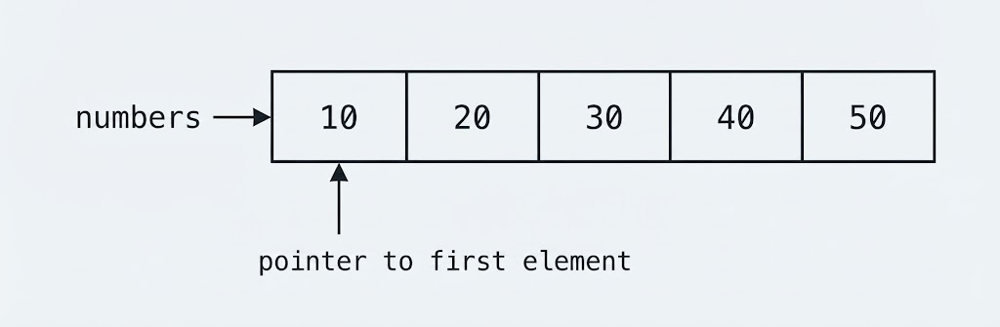
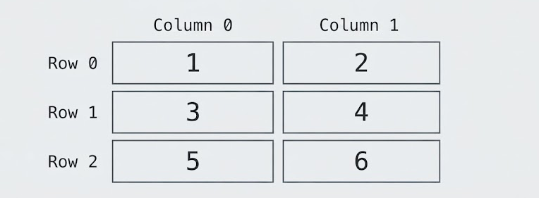
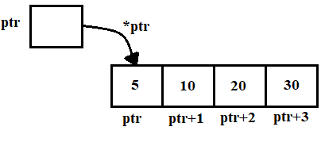
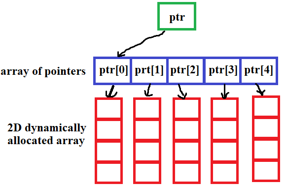

## Objectives:
- Working Pointers and Reference
- Exploring Memory Model and Working with Dynamic Memory Allocation
- Working with Fixed Size and Dynamic Size Arrays
- Working with Vectors

## Pointers and Reference
### Introduction
When a program runs, the computer needs somewhere to store the data it works with: variables, objects, arrays, and other information. This storage is memory, and each location in memory has its own address.

We can think of memory as a huge collection of numbered storage locations. Each location has an address, and that location can contain some value.

For example:
```cpp
int A = 5;
```
Here, C++ asks the system to provide a memory location capable of storing an `int`. The value `5` is then stored there.

C++ gives us direct access to these addresses. To obtain the address of a variable, we use the **address-of operator** `&`:
```cpp
#include <iostream>
using namespace std;

int main() {
    int A = 5;

    cout << "Value of A: " << A << endl;
    cout << "Address of A: " << &A << endl;

    return 0;
}
```
The exact address will usually be different each time the program runs.

The important idea is:
```text
A     → value stored in the variable
&A    → memory address where A is stored
```
### Pointers
A **pointer** is a variable whose value is a memory address. Instead of storing `5` directly, a pointer can store the address of the variable containing `5`.

To declare a pointer, we specify the type of data it points to and place `*` next to the pointer name:
```cpp
int* p1;
```
This means `p1` is a pointer to an `int`.

We can then make it point to an existing variable by assigning it that variable's address:
```cpp
#include <iostream>
using namespace std;

int main() {
    int a = 5;
    int* ptr = &a;

    cout << "The memory address of a is " << ptr;

    return 0;
}
```

Now the relationship looks like this:



#### Dereferencing a Pointer
Knowing an address is useful, but often we want to access the value stored at that address.

This is done using the `*` operator, called the dereference operator.
```cpp
#include <iostream>
using namespace std;

int main() {
    int a = 2;
    int* p1 = &a;

    cout << "The memory address is " << p1 << endl;
    cout << "The value stored there is " << *p1 << endl;

    return 0;
}
```
Here:
```cpp
p1
```
gives us the address.

While:
```cpp
*p1
```
gives us the value stored at that address.

So we can think of it as:
```text
p1   → "Where is it?"
*p1  → "What is stored there?"
```
#### Modifying Data Through a Pointer
Dereferencing a pointer does not only allow us to read a value. If the pointer points to writable memory, we can also modify that value.
```cpp
#include <iostream>
using namespace std;

int main() {
    int a = 2;
    int* p1 = &a;

    cout << "The value of a is " << a << endl;

    *p1 = 10;

    cout << "The value of a changed to " << a << endl;

    return 0;
}
```
When we write:
```cpp
*p1 = 10;
```
we are telling the computer go to the memory location stored inside `p1` and put `10` there.

Since `p1` points to `a`, the value of `a` changes .
#### `nullptr`
A pointer does not always have to point to an object. C++ provides `nullptr` to represent a pointer that points to nothing:
```cpp
int* p = nullptr;
```
This is safer and clearer than using values such as `0` or `NULL`.

Before dereferencing a pointer, we can check whether it actually points to something:
```cpp
if (p != nullptr) {
    cout << *p;
}
```
Dereferencing a null pointer is invalid and leads to undefined behavior.
#### Pointer Arithmetic
Pointers can also participate in arithmetic.

For example:
```cpp
int numbers[] = {10, 20, 30, 40};

int* p = numbers;

cout << *p << endl;
cout << *(p + 1) << endl;
cout << *(p + 2) << endl;
```
This produces:
```text
10
20
30
```
When we add `1` to an `int*`, the pointer moves to the **next `int`**, not simply one byte forward.

Conceptually:
```text
p       → numbers[0]
p + 1   → numbers[1]
p + 2   → numbers[2]
```
The compiler knows the size of the pointed-to type and adjusts the address accordingly. Pointer arithmetic is therefore particularly useful when working with arrays.
### Const with Pointers
`const` becomes especially important when working with pointers because there are different things we can make constant.

we can pointer to constant
```cpp
const int* p = &a;
```
here `p` can point to an int, but we cannot modify that int through p.

For example:
```cpp
int a = 10;
const int* p = &a;

cout << *p;

// *p = 20; // Error
```
However, the pointer itself can point somewhere else:
```cpp
int b = 20;

p = &b;
```
We can also create constant pointer
```cpp
int* const p = &a;
```
Here `p` itself cannot be changed to point somewhere else.

But the value it points to can still be modified:
```cpp
*p = 20;
```
while this is not allowed:
```cpp
p = &b; // Error
```
Finally we have  constant pointer to constant
```cpp
const int* const p = &a;
```
Now:
- the pointer cannot point somewhere else
- the value cannot be modified through the pointer

### References
Before going deeper into pointers, we should also understand references, because they provide another way to work with an existing object.

A reference is an alias for another variable.
```cpp
int a = 5;
int& ref = a;
```
Now `ref` refers to the same object as `a`.
```cpp
ref = 10;
```
changes `a` as well.

#### Const References
A reference can also be made `const`:
```cpp
int x = 10;
const int& ref = x;
```
This means that **we cannot modify** `x` **through** `ref`.
```cpp
std::cout << ref; // 10

// ref = 20;      // Error
```
Notice that `x` itself is not necessarily `const`. We can still modify it directly:
```cpp
x = 20;

std::cout << ref; // 20
```

The `const` only prevents modification **through that particular reference**.

Const references are especially useful when we want to pass an object to a function **without copying it and without allowing the function to modify it**.

```cpp
void print(const std::string& name) {
    std::cout << name;
}
```

Here, `name` refers directly to the original `std::string`. No copy of the string is required, and the function cannot modify the original string through `name`.
### Reference vs Pointer
Pointers and references can both give us indirect access to an object, but they behave differently.

A pointer:
```cpp
int* p = &a;
```
stores an address and can be changed to point somewhere else:
```cpp
p = &b;
```
A reference:
```cpp
int& ref = a;
```
acts as another name for `a`. It is not normally reseated to refer to another object.
## Memory Architecture and Dynamic Memory Allocation
So far, we have treated memory as one large space. In reality, a running C++ program organizes its memory into different areas with different purposes.

The most important ones to understand are:
- **Stack**
- **Heap**
- **Static storage**
- **Dynamic storage**

The exact implementation depends on the operating system, compiler, and runtime, but the general model is useful for understanding C++.
### The Stack
The **stack** is commonly used for local variables and function call information.

For example:
```cpp
int main() {
    int a = 5;
    int b = 10;
}
```
`a` and `b` have automatic storage duration. Their lifetime is tied to the scope in which they are declared. when execution enters the scope, the objects are created, after the execution leaves the scope, their lifetimes end.
### The Heap
The **heap** is commonly used for dynamically allocated memory. Unlike an ordinary local variable, dynamically allocated memory can remain alive independently of the scope where it was allocated.

For example:
```cpp
int* p = new int;
*p = 5;
```
The pointer `p` itself may be a local variable, while the `int` created by `new` has dynamic storage duration.

This distinction becomes important:
```text
Stack                         Dynamic storage

p ────────────────┐
                  │
                  ▼
              ┌───────┐
              │   5   │
              └───────┘
```
The pointer and the object it points to do not necessarily live in the same memory area.
### Storage Duration and Object Lifetime
Memory and object lifetime are closely related, but they are not exactly the same thing. An **object's lifetime** is the period during which that object exists and can be used as an object of its type.  

So far, we have seen two different ways an object's storage can be managed.

With **automatic storage duration**, the lifetime is controlled automatically by the scope:
```cpp
void function() {

    int x = 10;

}
```
`x` is created when execution reaches its declaration and its lifetime ends when execution leaves the scope.

With **dynamic storage duration**, the object is created explicitly and can remain alive until we destroy it:
```cpp
int* p = new int(10);

delete p;
```
Here, the dynamically allocated `int` exists independently of the scope of `p`.

There is also another important kind of storage duration: static storage duration.
#### Static Storage
Objects with static storage duration exist for the entire lifetime of the program. They are created before or during program initialization and remain alive until the program terminates.

For example:
```cpp
int global = 10;

int main() {

    cout << global;

}
```
`global` has static storage duration. It exists from the beginning of the program until the program ends.

We can also explicitly use the `static` keyword for a local variable:
```cpp
void counter() {

    static int count = 0;

    count++;

    cout << count << endl;
}
```
Normally, a local variable is created each time the function is called and destroyed when the function returns. But because `count` is declared as `static`, it is created only once and keeps its value between function calls.

```
counter(); // 1
counter(); // 2
counter(); // 3
```
So, as a simple mental model:
- **Automatic storage** lifetime is tied to a scope.
- **Dynamic storage** lifetime is controlled explicitly.
- **Static storage** lifetime lasts for the entire program.


### Dynamic Memory Allocation
Pointers become powerful when we need memory whose size or lifetime is determined during program execution.

Normally, when we write:
```cpp
int a = 5;
```
the object is created automatically.

But C++ also allows us to explicitly request memory using the `new` operator.
```cpp
int* p1 = new int;
```
Here, `new int` dynamically creates an `int` and returns its address, that address is stored inside `p1`.

We can then use the pointer to access the allocated object:
```cpp
#include <iostream>
using namespace std;

int main() {
    int* p1 = new int;

    *p1 = 5;

    cout << "The value stored is " << *p1;

    delete p1;

    return 0;
}
```
#### Initializing Dynamically Allocated Memory
We can initialize the object directly when using `new`.
```cpp
int* p1 = new int(5);
```
Now the dynamically allocated `int` starts with the value `5`.

We can also write:
```cpp
int* p1 = new int();
```
For a value-initialized `int`, this initializes it to zero

For example:
```cpp
#include <iostream>
using namespace std;

int main() {
    int* p1 = new int();

    cout << *p1 << endl;

    *p1 = 5;

    cout << *p1 << endl;

    delete p1;

    return 0;
}
```
#### Memory Deallocation
Every allocation with `new` must have a corresponding `delete` when we are responsible for that dynamically allocated object.
```cpp
int* p1 = new int(5);

cout << *p1;

delete p1;
```
`delete` destroys the dynamically allocated object and releases its associated storage.

If we allocate memory but lose the pointer without releasing the memory, that memory can no longer be accessed or reclaimed by the program, this is called a **memory leak**.

For example:
```cpp
int* p = new int(5);

p = nullptr;
```
The allocated `int` still exists, but we have lost the address needed to access or delete it. The memory has effectively been leaked.
### Dangling Pointers
A dangling pointer is a pointer that still contains an address, but the object at that address no longer exists.

For example:
```cpp
int* p = new int(5);

delete p;

cout << *p; // Dangerous
```
After:
```cpp
delete p;
```
the object no longer exists, the pointer `p` still contains the old address, but that address is no longer a valid `int` object that we can access.

A common defensive practice is:
```cpp
delete p;
p = nullptr;
```
Now the pointer clearly represents that it no longer points to a valid object.
### Double Deletion
Another serious mistake is deleting the same dynamically allocated object more than once:
```cpp
int* p = new int(5);

delete p;
delete p; // Error
```
The first `delete` releases the object. the second attempts to release it again, which results in **undefined behavior**.

Setting the pointer to `nullptr` after deletion can help prevent this:
```cpp
delete p;
p = nullptr;

delete p; // safe: deleting nullptr has no effect
```

## Working with Arrays

### Introduction
So far, we have seen how variables store individual values and how pointers allow us to work with memory addresses.

But what happens when we want to store **multiple values of the same type**? For example, imagine that we want to store the grades of five students:
```cpp
int grade1 = 15;
int grade2 = 18;
int grade3 = 12;
int grade4 = 16;
int grade5 = 14;
```
This works, but it quickly becomes inconvenient. Instead, C++ provides **arrays**.

An array is a variable that can store multiple values of the same data type. These values are stored **consecutively in memory**.

We can create an array like this:
```cpp
int grades[5];
```
This creates an array capable of storing five `int` values.

We can then access each element using an index:
```cpp
grades[0] = 15;
grades[1] = 18;
grades[2] = 12;
grades[3] = 16;
grades[4] = 14;
```
Notice that the first element has index `0`, not `1`.



The elements are stored next to each other in memory.

### Fixed-Size Arrays
The array we created above has a fixed size:
```cpp
int grades[5];
```
The number `5` tells C++ that this array contains five elements. the  limitation here is that the size of this array does not change.

If we create:
```cpp
int numbers[5];
```
we cannot simply make it:
```cpp
int numbers[10];
```
later.
### Arrays and Pointers
Because array elements are stored consecutively in memory, we can navigate through an array using a pointer.

Consider:
```cpp
int numbers[5] = {10, 20, 30, 40, 50};
```
The array might look conceptually like this:



We can create a pointer to the first element:
```cpp
int* p = numbers;
```
Here, `numbers` is converted to a pointer to its first element, this is called array-to-pointer decay.

In many expressions:
```cpp
numbers
```
behaves like:
```cpp
&numbers[0]
```
So:
```cpp
int* p = numbers;
```
is effectively pointing to the first element.

We can then access the elements using pointer arithmetic:
```cpp
cout << *p << endl;
cout << *(p + 1) << endl;
cout << *(p + 2) << endl;
```
### Multidimensional Arrays
Arrays can also contain other arrays. This allows us to create multidimensional arrays.

A common example is a 2D array, which can represent a table with rows and columns.
```cpp
int table[3][2] = {
    {1, 2},
    {3, 4},
    {5, 6}
};
```
We can visualize it like this:



To access an element, we use two indexes, the first index specifies the row and second index specifies the column.
```cpp
table[0][1]
```
means  Row `0`, column `1`.
### Dynamic-Sized Arrays
Fixed-size arrays are useful, but sometimes we do not know the required size when writing the program.

Imagine that a program asks the user how many numbers they want to store, we cannot always know that number beforehand.

This is where **dynamic memory allocation** becomes useful.

Instead of creating the array directly:
```cpp
int numbers[5];
```
we can allocate memory during program execution:
```cpp
int* ptr = new int[5];
```
Here:
- `new` allocates memory.
- `int[5]` requests space for five integers.
- `new` returns the address of the first element.
- `numbers` stores that address.

To access the first value, we use:
```cpp
*ptr
```

because `ptr` points to the beginning of the allocated array.

To access the next value:
```cpp
*(ptr + 1)
```
Then:
```cpp
*(ptr + 2)
```
and so on.



We can also access value like a normal array:
```cpp
ptr[0] = 10;
ptr[1] = 20;
ptr[2] = 30;
```
#### Resizing a Dynamic Array
What if we initially allocate space for five elements, but later discover that we need ten?

We cannot simply change:
```cpp
new int[5]
```
into:
```cpp
new int[10]
```
The existing memory block has a fixed size, instead, we need to allocate a new, larger block of memory and copy the old data into it.

The general process is:
1. Allocate a new block with the requested size.
2. Copy the existing elements into the new block.
3. Release the old block.
4. Make the original pointer point to the new block.
5. Continue using the new array.
    

For example:
```cpp
#include <iostream>
using namespace std;

int main() {

    int* p1 = new int[5];

    *(p1)     = 1;
    *(p1 + 1) = 2;
    *(p1 + 2) = 3;
    *(p1 + 3) = 4;
    *(p1 + 4) = 5;
    
    // create new array
    int* tmp = new int[10];
    
    // copy element to new array
    for (int i = 0; i < 5; i++) {
        *(tmp + i) = *(p1 + i);
    }
    
    // delete old array
    delete[] p1;
    
    // make pointer point to new array
    p1 = tmp;

    *(p1 + 5) = 6;
    *(p1 + 6) = 7;
    *(p1 + 7) = 8;
    *(p1 + 8) = 9;
    *(p1 + 9) = 10;

    for (int i = 0; i < 10; i++) {
        cout << "The value in position "
             << i << " is "
             << *(p1 + i) << endl;
    }

    delete[] p1;

    return 0;
}
```
The important part is:
```cpp
int* tmp = new int[10];
```
We create a new memory block.

Then:
```cpp
for (int i = 0; i < 5; i++) {
    *(tmp + i) = *(p1 + i);
}
```
copies the old values.

Then:
```cpp
delete[] p1;
p1 = tmp;
```
releases the old memory and makes `p1` point to the new block, after the old array is released we can then fill the new positions.
#### Array Memory Deallocation
Every dynamically allocated array must be freed when it is no longer needed.

When we allocate an array using `new[]`:
```cpp
int* p1 = new int[10];
```
we must release it using `delete[]`:
```cpp
delete[] p1;
```
Notice the `[]` after `delete`. It tells C++ that `p1` points to an array and that the entire array should be deallocated.
### Dynamic-Sized 2D Arrays
We have seen how to create a fixed-size 2D array:
```cpp
int table[4][3];
```
But what if the number of rows or columns is not known beforehand?

We can combine pointers and dynamic memory allocation to create a dynamically allocated 2D structure. One common approach is to create an array of pointers.

For example:
```cpp
int** ptr = new int*[4];
```
Here:
```cpp
int**
```
means that `ptr` is a pointer to a pointer that point to an `int`.

The first allocation creates four pointers, Each pointer can then point to its own dynamically allocated array.

For example:
```cpp
*(ptr) = new int[4];
*(ptr + 1) = new int[4];
*(ptr + 2) = new int[4];
*(ptr + 3) = new int[4];
```
Now we effectively have:



Each row is its own dynamically allocated array, which means the rows do not necessarily have to have the same size.

To access element we use doube deferencing
```cpp
*(*(ptr) + 1) = 2; // row 1 column 2
```
#### Multidimensional Dynamic Arrays
We are not limited to two dimensions, the same idea can be extended to more dimensions by adding more levels of pointers.

For example:
```cpp
int*** ptr;
```
could be used to build a dynamically allocated 3D structure. However, the more levels of pointers we introduce, the more complicated memory management becomes.
### Strings
We saw before in lecture one strings, strings are essentially a sequence of characters stored in a character array and terminated by a special character called the **null character** `\0`:

```cpp
char name[4] = {'A', 'l', 'i', '\0'};
```
The null character tells C string functions where the string ends.
#### Dynamically Allocated C Strings
Since a C string is a character array, we can dynamically allocate one using a `char*`.

For example:
```cpp
char* name = new char[4];
*(name)     = 'A';
*(name + 1) = 'l';
*(name + 2) = 'i';
*(name + 3) = '\0';
cout << "My name is " << name << endl;
```
The memory looks like:
```text
name
 ↓
┌─────┬─────┬─────┬─────┐
│ 'A' │ 'l' │ 'i' │ '\0'│
└─────┴─────┴─────┴─────┘
```
We can also resize string and do all dynamic array operation on them we can aslo have array of string by using the double pointer methods
```cpp
char** names = (char**)malloc(3*sizeof(char*)) ;
    *(names) = (char*)malloc(sizeof(char)*4);
    *(names+1) = (char*)malloc(sizeof(char)*6);
    *(names+2) = (char*)malloc(sizeof(char)*6);
    **(names)='A';
    *(*(names)+1)='l';
    *(*(names)+2)='i';
    *(*(names)+3)='\0';

    cout << *(names);
```
#### `std::string`
Managing character arrays manually requires allocating memory, copying characters, resizing arrays, and handling the null terminator `'\0'`.  C++ provides `std::string` to handle these details automatically.

We include it using:
```cpp
#include <string>
```
For example:
```cpp
#include <iostream>
#include <string>

using namespace std;

int main() {
    string name = "Ali";
    cout << name << endl;
    name = "Alice";
    cout << name << endl;
    return 0;
}
```
Unlike C-style strings, `std::string` manages its own memory and can change its size automatically.

We can create strings in several ways:
```cpp
string first = "Ali";       // Initialize with text
string second;              // Empty string
second = "Alice";           // Assign a value
string stars(5, '*');       // "*****"
string copy = first;        // Copy another string
```
We can modify individual characters using their indices, append text using `+=`, or combine strings using `+`.
```cpp
string name = "Ali";

name[0] = 'A';
name += " Anunnaki";

string greeting = "Hello " + name;

cout << greeting << endl;
```
Output:
```
Hello Ali Anunnaki
```
We can also use the `find()` function to search and returns the starting position of the first occurrence of the specified text. If it is not found, it returns `string::npos`.
```cüü
string text = "Hello World";

size_t position = text.find("World");

if (position != string::npos) {
    cout << "Found at position " << position;
}
```
We can extract part of a string using `substr()` and get its length using `size()`.
```cpp
string text = "Hello World";

cout << text.substr(6, 5) << endl;  // World
cout << text.size() << endl;        // 11
```
`substr(start, count)` extracts `count` characters beginning at `start`, while `size()` returns the number of characters in the string.
#### `std::string_view`
Sometimes, we only need to read a string without copying it. C++ provides `std::string_view` for this purpose.

We include it using:
```
#include <string_view>
```
For example:
```cpp
#include <iostream>
#include <string>
#include <string_view>

using namespace std;

void print(string_view text) {
    cout << text << endl;
}

int main() {
    string name = "Alice";

    print(name);

    return 0;
}
```
Here, `string_view` allows the function to access the existing characters without creating another `std::string` copy.

## Vectors
So far, we have seen how arrays allow us to store multiple values of the same type in consecutive memory locations. We have also seen how dynamic arrays allow us to allocate memory during program execution.

However, working with dynamically allocated arrays requires us to manage memory manually. We need to allocate memory, keep track of the array's size, copy elements when resizing, and release the memory when we no longer need it.

C++ provides a container called **`std::vector`** that handles these operations for us.

A `std::vector` is a dynamic array that can automatically grow or shrink as we add or remove elements. Unlike a C-style array, we do not need to decide its final size when we declare it.

To use `std::vector`, we include the `<vector>` header:
```cpp
#include <iostream>
#include <vector>

using namespace std;

int main() {
    vector<int> numbers = {10, 20, 30, 40, 50};

    for (int i = 0; i < numbers.size(); i++) {
        cout << numbers[i] << endl;
    }

    return 0;
}
```
Here:
```
vector<int> numbers = {10, 20, 30, 40, 50};
```
creates a vector named `numbers` that stores five integers.

The `int` inside the angle brackets specifies the type of elements the vector stores. We can create vectors of other types, such as `double`, `char`, or `string`.
```cpp
vector<int> numbers;
vector<double> prices;
vector<char> letters;
vector<string> names;
```
Unlike a fixed-size array, we can add more elements to a vector whenever we need them.
### Adding Elements to a Vector
When we create a vector, we do not need to specify how many elements it will eventually contain.

For example:
```cpp
vector<int> numbers;
```
This creates an empty vector of integers.

We can add elements using the `push_back()` function:
```cpp
numbers.push_back(10);
numbers.push_back(20);
numbers.push_back(30);
```
Each call adds a new element to the end of the vector.
### Accessing and Modifying Elements
Just like ordinary arrays, vectors use indexes to access their elements. The first element has index `0`, the second has index `1`, and so on.
```cpp
vector<int> numbers = {10, 20, 30, 40};

cout << numbers[0] << endl; // 10
cout << numbers[1] << endl; // 20
```
We can also modify an element by assigning a new value to its index:
```
numbers[1] = 100;
```
Now the vector contains:
```
10  100  30  40
```
However, we must remember that indexes still have limits. Accessing an element outside the vector's valid range using `operator[]` results in undefined behavior.

If we want bounds-checked access, we can use the `at()` function:
```
cout << numbers.at(1); // 100
```
If the index is outside the valid range, `at()` throws a `std::out_of_range` exception.
### Getting the Size of a Vector
When working with arrays, we often need to know how many elements they contain. With a vector, we can use the `size()` function.
```cpp
vector<int> numbers = {10, 20, 30, 40, 50};

cout << numbers.size(); // 5
```
### Removing Elements
Just as we can add elements, we can also remove them. The `pop_back()` function removes the last element of the vector.
```cpp
vector<int> numbers = {10, 20, 30, 40};

numbers.pop_back();
```
Now the vector contains:
```
10  20  30
```
We can also remove all elements using `clear()`:
```
numbers.clear();
```
After this operation, the vector's size becomes zero.

It is important to understand that clearing a vector does not necessarily release all the memory it has allocated. 
### Resizing a Vector
Earlier, when working with dynamic arrays, we saw that increasing their size required allocating a new memory block, copying the existing elements, and releasing the old memory.

With `std::vector`, we can use the `resize()` function to change the number of elements.
```cpp
vector<int> numbers = {10, 20, 30};

numbers.resize(5);
```
The vector now contains five elements:
```
10  20  30  0  0
```
The new elements are value-initialized, which means they are initialized to zero in this case.

We can also shrink the vector:
```
numbers.resize(2);
```
Now it contains only:
```
10  20
```
The vector handles the necessary operations internally.

However, resizing does not guarantee that the vector's allocated memory will shrink when its size decreases. The number of elements and the amount of allocated storage are two different concepts.
#### Size vs Capacity
To understand how vectors manage memory, we need to distinguish between two concepts: **size** and **capacity**.

The **size** is the number of elements currently stored in the vector.

The **capacity** is the number of elements the vector can hold in its currently allocated storage without needing to reallocate that storage.

For example:
```cpp
vector<int> numbers = {10, 20, 30};

cout << "Size: " << numbers.size() << endl;
cout << "Capacity: " << numbers.capacity() << endl;
```
The size is `3`, but the capacity may be greater than `3`.

The exact capacity depends on how the vector manages its memory, so we should not assume a particular value.

Conceptually, the memory might look like this:

```
Allocated storage
┌──────┬──────┬──────┬──────┬──────┐
│  10  │  20  │  30  │      │      │
└──────┴──────┴──────┴──────┴──────┘
└──────────┘  └───────────────────┘
  Size = 3          Extra capacity
```
When we add elements using `push_back()`, the vector can use its existing capacity if there is enough room.

When the available capacity is insufficient, the vector may allocate a larger memory block and move or copy its elements into the new storage.

### Iterating Through a Vector
We have already seen how to access vector elements using indexes. However, C++ provides another convenient way to iterate through a vector: the range-based `for` loop.
```cpp
vector<int> numbers = {10, 20, 30, 40, 50};

for (int number : numbers) {
    cout << number << endl;
}
```
For each iteration, `number` receives a copy of the current element.

If we want to modify the original elements, we can use a reference:
```cpp
for (int& number : numbers) {
    number *= 2;
}
```
Now each element is multiplied by two.

We can also use a reference to avoid copying an element when we only need to read it:
```cpp
for (const int& number : numbers) {
    cout << number << endl;
}
```
For simple types such as `int`, copying is inexpensive, so using a reference is not always necessary. For larger objects, references can avoid unnecessary copies.

### Vectors and Pointers
Since vectors store their elements in contiguous memory, we can also work with their elements using pointers.

Consider:
```cüü
vector<int> numbers = {10, 20, 30, 40, 50};

int* ptr = numbers.data();
```
The `data()` function returns a pointer to the vector's element storage.

We can then access the elements using pointer arithmetic:
```cpp
cout << *ptr << endl;       // 10
cout << *(ptr + 1) << endl; // 20
cout << *(ptr + 2) << endl; // 30
```
This is similar to what we did with C-style arrays.

We can also modify elements through the pointer:
```
*ptr = 100;
```
Now the first element of the vector is `100`.

However, we must be careful when working with pointers to vector elements. Some vector operations, such as those that cause reallocation, can invalidate pointers, references, and iterators referring to its elements.

For example, adding elements may cause the vector to allocate a new memory block. If that happens, a pointer obtained from `data()` may no longer be valid.
## Tasks :
### Task 1 :

Write a program in C++ that reads a string from the user and calculates its length using a pointer.
1. The program should prompt the user to enter a string.
2. Use a pointer to traverse the string and calculate its length.
3. Display the length of the string.
Resolve this with ``string`` instead of ``char *``.
#### Hint :
The end of the string is represented by the character `\0`.
### Task 2 :

Write a program that asks the user for the number of subjects they have, and for each subject, the number of tests they took. The program should then prompt the user to input the marks for each test in each subject and store them in a 2D dynamic array. After collecting the marks, the program should:

1. Calculate and display the average mark for each subject.
2. Calculate and display the total average mark across all subjects.
3. Display the subject number, the marks for each test in that subject, and the average for that subject.

Finally, the program should display the overall total average across all subjects.
