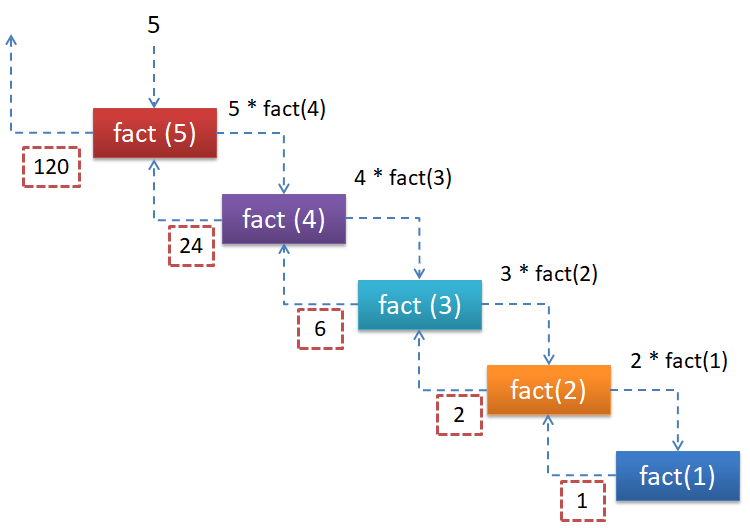

## Objectives :
- Learning function declarations, definitions, parameters, arguments, and return values.
- Understanding pass-by-value, pass-by-reference, and `const` references.
- Understanding scope, name lookup, storage duration, and object lifetime.
- Working with function overloading, default arguments, and inline functions.
- Organizing a C++ program using header files and multiple `.cpp` files.
- Using include guards and `#pragma once`.

## Functions:
### Introduction:
Till now, we have written programs by placing instructions inside `main()` or inside other blocks of code. However, as our programs become larger, we often need to perform the same operation in several places. Copying and pasting the same instructions repeatedly makes a program longer, harder to read, and more difficult to maintain.

To address this issue, C++ provides **functions**. A function groups instructions under a name so that we can call those instructions whenever we need them. Instead of repeating the implementation, we write it once and reuse it.

For example, if our program needs to calculate the cube of several numbers, we can create a `cube()` function and call it for each number.

### Creating Functions :
To create a function, we need to follow these steps:

- Identify the block of code that we want to turn into reusable code.
- Choose a function name.
- Identify the information the function needs. These inputs are called **parameters**.
- Decide whether the function should return a result and, if so, choose its return type.
- Write the instructions that the function will execute.

A function definition generally follows this structure:
```cpp
return_type function_name(parameter_list) {
    // Instructions
    return value;
}
```
The return type tells us what kind of result the function produces. The function name identifies the operation, and the parameter list describes the inputs it receives. The body, enclosed by `{}` braces, contains the instructions to execute.

Let's create a function that calculates the cube of a number:
```cpp
float cube(float n) {
    return n * n * n;
}
```
Here, `float` is the return type, `cube` is the function name, and `float n` declares a parameter named `n`. The statement `return n * n * n;` calculates the cube and sends the result back to the code that called the function.

#### Calling a Function :
Defining a function does not execute it. To execute its body, we must **call** it by writing its name followed by parentheses containing the arguments.
```cpp
float result = cube(3.0f);
```
In this call, `3.0f` is the **argument**. Its value is passed to the parameter `n`, and the function returns `27.0f`, which is stored in `result`.
```cpp
#include <iostream>
using namespace std;

float cub(float n){
	return n * n * n;
}

int main(){
	float r;
	float n;
	
	cout << "Enter number : ";
	cin >> n;
	r = cub(n);
	cout << "The cub of " << n << " is " << r << endl;
	
	return 0;
}
```
When `cube(n)` is called, execution enters the `cube` function. After the `return` statement is executed, the result is given back to `main()`, and execution continues from the statement after the call.

### Function Declaration and Function Definition:
So far, we have written the complete function before `main()`. This works because the compiler has already seen the function definition when it reaches the call. However, in larger programs, we may want to place `main()` first and put the implementations later.

For this, C++ lets us **declare** a function before defining it.

A **function declaration**, commonly called a **function prototype**, tells the compiler the function's name, return type, and parameter types. It ends with a semicolon and does not contain the function body.
```cpp
float cube(float n);  // Function declaration

int main() {
    std::cout << cube(3.0f);
    return 0;
}

float cube(float n) { // Function definition
    return n * n * n;
}
```
The declaration lets the compiler check the call `cube(3.0f)` even though the function's implementation appears later.

A **function definition** provides the actual implementation: the instructions that execute when the function is called.
#### Parameters and Arguments :
A **parameter** is a variable declared in a function's parameter list. An **argument** is the value or expression supplied when the function is called.
```cpp
float sum(float a, float b); // a and b are parameters

int main() {
    float result = sum(4.0f, 6.0f); // 4.0f and 6.0f are arguments
}
```
In this example, the function receives two inputs. Each argument initializes the corresponding parameter.
#### Return Values :
A return value allows a function to communicate a result to its caller.
```cpp
int sum(int a, int b) {
    return a + b; // return value
}
```
We can store the returned value, print it, or use it inside another expression:
```cpp
int result = sum(4, 6);
std::cout << sum(10, 20);
int larger_sum = sum(sum(1, 2), sum(3, 4));
```
A function can also perform an action without returning a result:
```cpp
void print_message() { // we use void when there is no return value 
    std::cout << "Hello!\n";
}
```
Calling `print_message()` executes the output operation, but there is no result to assign to a variable.
### Passing Arguments to Functions :
When we pass an argument to a function, the way its parameter is declared determines whether the function receives a separate value or can access the original object.

The two important forms are **pass-by-value** and **pass-by-reference**.
#### Pass-by-Value :
By default, ordinary parameters are passed by value. The parameter is a separate object initialized from the argument. Changing the parameter does not change the original variable.

Let's illustrate this with a function that tries to swap two integers:
```cpp
#include <iostream>

void swap(int a, int b) {
    int temp = a;
    a = b;
    b = temp;
}

int main() {
    int a = 5;
    int b = 6;

    swap(a, b);

    std::cout << "a = " << a << ", b = " << b << '\n';
    return 0;
}
```
The output is:
```text
a = 5, b = 6
```
Why did the values not change? When `swap(a, b)` is called, the parameters `a` and `b` inside the function are separate copies of the variables in `main()`. The function swaps those copies, then its local parameters are destroyed when the call ends. The original variables remain unchanged.

Pass-by-value is useful when a function needs its own copy of an input and should not modify the caller's object.
#### Pass-by-Reference :
Sometimes, we want a function to work directly with the original variables. We can manage that by using reference parameter we add `&` to the parameter's type.
```cpp
#include <iostream>

void swap(int& a, int& b) {
    int temp = a;
    a = b;
    b = temp;
}

int main() {
    int a = 5;
    int b = 6;

    std::cout << "Before swap: a = " << a << ", b = " << b << '\n';
    swap(a, b);
    std::cout << "After swap:  a = " << a << ", b = " << b << '\n';

    return 0;
}
```
The output is:
```text
Before swap: a = 5, b = 6
After swap:  a = 6, b = 5
```
In `void swap(int& a, int& b)`, the parameters are references to the arguments. They act as alternative names for the original objects. Therefore, assigning a new value to `a` or `b` changes the corresponding variables in `main()`.
#### `const` Reference Parameters :
If we want to read an object without copying it or modifying it, we can use a **constant reference**:
```cpp
#include <iostream>
#include <string>

void print_name(const std::string& name) {
    std::cout << "Name: " << name << '\n';
}

int main() {
    std::string name = "Ali";
    print_name(name);
    return 0;
}
```
The parameter `const std::string& name` refers to the original string, but the function cannot modify that string through `name`.

This is especially useful for large objects, such as strings and vectors, because it avoids making a copy while preserving read-only access.
### Scope of Variables :
Let's suppose we create a function that calculates the sum of two numbers and stores the result in a variable named `result`.
```cpp
float sum(float a, float b) {
    float result = a + b;
    return result;
}
```
What happens if we try to access `result` directly from `main()`?
```cpp
int main() {
    float r = sum(2.0f, 3.0f);
    std::cout << result; // Error: result is not declared in this scope
}
```
The compiler reports an error because `result` is declared inside `sum()`. It is not visible by that name from `main()`.

In programming, **scope** refers to the region of the program where a name can be used without qualification. Scope answers the question: Where can this name be found by the compiler?
#### Local Scope and Block Scope:
A variable declared inside a function body has block scope. It can be used from its declaration to the end of the block, subject to the usual rules for nested blocks and name lookup.
```cpp
void example() {
    int x = 10;

    {
        int y = 20; 
        std::cout << x << ' ' << y << '\n';
    }

    std::cout << x << '\n';
    // std::cout << y; // Error: y is outside its scope
}
```
The variable `x` belongs to the outer block, so it is accessible in the nested block. The variable `y` belongs to the nested block, so it cannot be used after that block ends.

A variable declared in a function is often called a **local variable**. More precisely, local variables are commonly block-scoped names whose objects have automatic storage duration unless another storage-duration rule applies.
#### Global Scope :
A variable declared outside every function and class, at namespace scope, can be visible to functions that appear after its declaration, subject to name lookup and linkage rules.
```cpp
#include <iostream>

int global_count = 0;

void increment() {
    ++global_count;
}

int main() {
    increment();
    increment();

    std::cout << global_count << '\n'; // 2
    return 0;
}
```
Here, `global_count` is declared outside the functions, so `increment()` and `main()` can use it.

Global variables can be useful when a value genuinely belongs to the program as a whole. However, using them everywhere makes it harder to understand which function changes a value. Prefer parameters and return values when they make the relationship between functions clearer.
#### Name Lookup and Shadowing :
When the compiler encounters a name, it must determine which declaration the name refers to. This process is called name lookup.

If a local variable has the same name as a global variable, the local variable can hide, or **shadow**, the global variable within its scope.
```cpp
#include <iostream>

int value = 100;

int main() {
    int value = 20;

    std::cout << value << '\n';  // 20: the local variable
    std::cout << ::value << '\n'; // 100: the global variable

    return 0;
}
```
The name `value` refers to the local variable inside `main()`. The scope-resolution operator `::` allows us to refer to the global variable in this example.

Choosing clear names and avoiding unnecessary shadowing helps make code easier to read.

### Function Overloading :
So far, we have used different function names to perform different operations. However, sometimes we want to perform the same conceptual operation with different types of data or different numbers of parameters.

For example, imagine we want to create a function that adds two numbers. We might want to add two integers, two decimal numbers, or even three integers. We could create a different function for each case, but this would require us to use different names for operations that are essentially the same, C++ help us to achieve this using **function overloading**.

Function overloading allows us to define multiple functions with the **same name**, as long as their parameter lists are different. Each function can handle a different version of the same operation.

When we call the function, the compiler looks at the arguments we pass and selects the appropriate version.

In other words, we use the same function name for the same kind of operation, and let the compiler choose which version to execute based on the arguments we provide.
For example, let's create a `sum()` function for integers and another for floating-point numbers:
```cpp
#include <iostream>

int sum(int a, int b) {
    return a + b;
}

double sum(double a, double b) {
    return a + b;
}

int main() {
    std::cout << sum(3, 4) << '\n';
    std::cout << sum(2.5, 4.2) << '\n';

    return 0;
}
```
When the compiler sees `sum(3, 4)`, it selects the overload that accepts two `int` parameters. When it sees `sum(2.5, 4.2)`, it selects the overload that accepts two `double` parameters.

The compiler chooses an overload by examining the function name, the number of arguments, and the types of the arguments. If it cannot find a best match, the call is ambiguous and compilation fails.

Functions cannot be overloaded using only different return types. For example, `int calculate(int)` and `double calculate(int)` cannot coexist as overloads.
### Default Arguments :
Sometimes, a function has a parameter that usually receives the same value. Instead of passing that value every time, we can provide a **default argument**.
```cpp
#include <iostream>

void greet(const std::string& name, const std::string& greeting = "Hello") {
    std::cout << greeting << ", " << name << "!\n";
}

int main() {
    greet("Ali");
    greet("Sara", "Welcome");

    return 0;
}
```
The first call supplies only `name`, so the default value `"Hello"` is used for `greeting`. The second call supplies both arguments and therefore uses `"Welcome"`.

Default arguments are normally specified in a declaration visible at the call site, not repeated in the later definition.
```cpp
void print_value(int value, int width = 5);

void print_value(int value, int width) {
    // Implementation
}
```
When a parameter has a default argument, parameters to its right must also have defaults. This is valid:
```cpp
void display(int value, int width = 5, char fill = ' ');
```
This is not valid:
```cpp
// void display(int value = 0, int width);
```
Default arguments can make an interface convenient, but too many defaults may make calls difficult to understand. Use them when the default behavior is sensible and predictable.
### Inline Functions
So far, we have seen how functions allow us to organize our code into smaller, reusable pieces. However, calling a function involves transferring control to that function and returning to the original code once the function finishes.

For very small functions that are called frequently, C++ provides the `inline` keyword, which allows the compiler to consider replacing a function call with the actual body of the function.
```cpp
inline int square(int value) {
    return value * value;
}
```
Here, we have defined a function called `square` that takes an integer and returns its square.

When we call the function:
```
int result = square(5);
```
The function returns `25`.

The `inline` keyword tells the compiler that this function is declared inline. The compiler may choose to replace the function call with its body, effectively performing the following operation:
```
int result = 5 * 5;
```
This can eliminate the overhead of a function call in some situations.

However, **the `inline` keyword does not guarantee that the compiler will replace the function call with its body.** The compiler decides whether this optimization is beneficial. Modern compilers can inline functions without the keyword, and they can also keep a normal function call even when `inline` is specified.

### Functions with a Variable Number of Parameters
Most functions we have seen accept a fixed number of parameters. For example, a function that adds two numbers expects two arguments, while a function that calculates the average of three numbers expects three.

However, sometimes we want a function to handle a variable number of arguments. Imagine we want to create a `sum()` function that can calculate the sum of two numbers, three numbers, five numbers, or even more, without defining a separate function for each case.

C++ provides several ways to achieve this. One traditional approach is to use **variadic functions**, which allow a function to accept a fixed number of parameters followed by a variable number of additional arguments.
### Working with Variable Arguments
To create a variadic function we need to follow this steps:
- **Include the `<cstdarg>` header:** This header provides the tools needed to access arguments passed through a variable-length argument list.
- **Define the function parameters:** We specify at least one named parameter, followed by three dots (`...`). The dots indicate that the function can receive additional arguments beyond its named parameters.
- **Use `va_list`:** This type allows us to access the additional arguments passed to the function.
- **Initialize the argument list with `va_start()`:** This macro prepares the argument list for reading. It takes the `va_list` variable and the last named parameter before the ellipsis.
- **Retrieve arguments using `va_arg()`:** This macro retrieves the next argument and advances the argument list. We must specify the expected type of the argument.
- **Finish with `va_end()`:** This macro performs the cleanup required for the argument list.
    
Let's put these concepts into practice by implementing our `sum()` function.
```cpp
#include <iostream>
#include <cstdarg>

int sum(int count, ...) {
    va_list ptr;
    va_start(ptr, count);
    int s = 0;
    for (int i = 0; i < count; i++) {
        s += va_arg(ptr, int);
    }
    va_end(ptr);
    return s;
}

int main() {
    int s;

    s = sum(5, 1, 2, 3, 4, 5);
    std::cout << "The sum is " << s << '\n';

    return 0;
}
```
First, we in the function declaration we had:
```cpp
int sum(int count, ...)
```
The parameter `count` tells the function how many additional arguments it should process. The three dots (`...`) indicate that the function can receive a variable number of additional arguments.

When we call:
```
sum(5, 1, 2, 3, 4, 5);
```
The first argument, `5`, is assigned to `count`. The remaining five arguments are the values we want to add.

Inside the function, we declare a variable of type `va_list`, this variable will keep track of our position in the list of additional arguments.
```cpp
va_list ptr;
```
We then initialize it:
```cpp
va_start(ptr, count);
```
This prepares `ptr` to access the additional arguments.

Next, used for loop to retrieve each argument:
```cpp
for (int i = 0; i < count; i++) {
    s += va_arg(ptr, int);
}
```
Each call to `va_arg(ptr, int)` retrieves the next argument as an `int`. The retrieved value is added to `s`, and the argument list advances to the next value.

After processing all the arguments, we call:
```
va_end(ptr);
```
This marks the end of our work with the variable argument list and performs any cleanup required by the implementation. Once we call `va_end()`, we must not use `ptr` to access the arguments again unless we initialize it again with `va_start()` or `va_copy()`.
#### Important Limitations
Although variadic functions provide flexibility, they have some important limitations.

First, the compiler does not automatically verify that the number of additional arguments matches `count`. If we provide an incorrect count, the function may attempt to access arguments that were never supplied, resulting in undefined behavior.

Second, the function must know the expected type of each argument. In our example, we use `va_arg(ptr, int)` because we expect every additional argument to be an integer. Retrieving an argument using an incompatible type can also cause undefined behavior.
#### Variadic Templates
C++11 introduced **variadic templates**, which allow functions to accept a variable number of arguments while preserving much stronger type information.

For example, we can implement a modern version of `sum()` like this:
```cpp
#include <iostream>

template <typename... Args>
auto sum(Args... args) {
    return (args + ...);
}

int main() {
    std::cout << sum(1, 2) << '\n';
    std::cout << sum(1, 2, 3) << '\n';
    std::cout << sum(1, 2, 3, 4, 5) << '\n';

    return 0;
}
```
Here, `typename... Args` declares a template parameter pack, allowing the function to accept a variable number of arguments. The expression `(args + ...)` is a fold expression, which combines the arguments using the addition operator.

Unlike the traditional approach, we do not need to pass an argument count or manually retrieve each argument. The compiler handles the argument pack and checks the operations used with the supplied types.

This implementation requires at least one argument because the `+` fold expression has no initial value.
### Recursive Functions
In programming, some problems can be solved by breaking them down into smaller versions of the same problem. Instead of writing separate instructions for every step, we can define a function that calls itself to solve each smaller part. This technique is called **recursion**.

Let's take a simple example: calculating the **factorial** of a non-negative integer.

The factorial of a number is the product of all positive integers from `1` up to that number. It is written using the symbol `!`.
- `0! = 1`
- `1! = 1`
- `3! = 3 × 2 × 1 = 6`
- `5! = 5 × 4 × 3 × 2 × 1 = 120`

Notice that we can express a factorial in terms of a smaller factorial. For example:
```
5! = 5 × 4!
```
Similarly:
```
4! = 4 × 3!
```
And:
```
3! = 3 × 2!
```
We can continue this process until we reach `0!`, which is defined as `1`.

This gives us a simple way to calculate a factorial: multiply the current number by the factorial of the number immediately before it.

Let's implement this idea using a recursive function:
```cpp
#include <iostream>

unsigned long long factorial(unsigned int n) {
    if (n == 0) {
        return 1;
    }

    return n * factorial(n - 1);
}

int main() {
    unsigned int n = 5;

    std::cout << "Factorial of " << n << " is "
              << factorial(n) << '\n';

    return 0;
}
```
When we call `factorial(5)`, the function checks whether `n` is equal to `0`. If it is, the function returns `1`. Otherwise, it multiplies `n` by the result of calling `factorial(n - 1)`.

Since `n` is initially `5`, the function calls itself with `4`. That call then calls `factorial(3)`, which calls `factorial(2)`, and so on.

The calls continue until `factorial(0)` is reached. At that point, the function returns `1`, allowing the previous calls to calculate their results.

We can represent this process as follows:



There are two important concepts to understand when working with recursive functions.
#### The Base Case
The base case defines when the function should stop calling itself.

In our example:
```cpp
if (n == 0) {
    return 1;
}
```
Without this condition, the function would continue calling itself indefinitely, eventually exhausting the available call stack.

#### The Recursive Case
The recursive case defines how the function reduces the problem and calls itself again.

In our example:
```
return n * factorial(n - 1);
```
Each call reduces `n` by one, bringing the problem closer to the base case.
### Higher-Order Functions
Sometimes, we want a function to perform a general task while allowing another function to determine how a specific part of that task should be performed.

C++ allows us to achieve this by passing functions as arguments. A function that takes another function as an argument, returns a function, or does both is called a **higher-order function**.

To understand why this is useful, let's consider a simple calculator. We want to perform different arithmetic operations on two numbers. Instead of creating a separate calculator function for each operation, we can create a single function that receives the operation it should perform.

Let's see how we can implement this:
```cpp
#include <iostream>

double add(double a, double b) {
    return a + b;
}

double subtract(double a, double b) {
    return a - b;
}

double calculate(double a, double b, double (*operation)(double, double)) {
    return operation(a, b);
}

int main() {
    double result = calculate(10.0, 4.0, add);
    std::cout << "Addition: " << result << '\n';

    result = calculate(10.0, 4.0, subtract);
    std::cout << "Subtraction: " << result << '\n';

    return 0;
}
```

Let's examine the calculate() function:
```cpp
double calculate(double a, double b, double (*operation)(double, double)) {
    return operation(a, b);
}
```
The first two parameters, a and b, represent the numbers we want to operate on. The third parameter, operation, is different from the parameters we have used before.
```cpp
double (*operation)(double, double)
```
This is a **function pointer**. It allows us to store a reference to a function and call that function through the pointer.

Let's break down its declaration:
- `double` at the beginning specifies the return type of the function being pointed to.
- `(*operation)` declares a pointer named operation.
- `(double, double)` specifies that the function must accept two double parameters.

Therefore, operation can point to any function that accepts two double values and returns a double. Both `add()` and `subtract()` satisfy these requirements.

Now, look at this function call:
```cpp
calculate(10.0, 4.0, add);
```
We pass three arguments: the first number, the second number, and the add function.

Notice that we write add, not `add()`. We are passing the function itself rather than calling it immediately.

Inside calculate(), the following expression executes the function we received:
```cpp
return operation(a, b);
```
If we pass add, the function calculates the sum. If we pass subtract, it calculates the difference.
### Using Lambda Expressions
Defining a separate function for every small operation can sometimes make our code unnecessarily long. C++ provides another way to pass behavior to a function: **lambda expressions**.

A lambda allows us to define a function directly where we need it, without giving it a separate name.

Let's modify our calculator to use lambda expressions:
```cpp
#include <iostream>

double calculate(double a, double b, double (*operation)(double, double)) {
    return operation(a, b);
}

int main() {
    double result = calculate(10.0, 4.0, [](double a, double b) {
        return a + b;
    });

    std::cout << "Addition: " << result << '\n';

    result = calculate(10.0, 4.0, [](double a, double b) {
        return a * b;
    });

    std::cout << "Multiplication: " << result << '\n';

    return 0;
}
```
Instead of defining separate functions for addition and multiplication, we provide each operation directly when calling `calculate()`.
```cpp
[](double a, double b) {
    return a + b;
}
```
This lambda accepts two double values and returns their sum. The empty square brackets `[]` introduce the capture list, the parentheses contain the parameters, and the braces contain the function body.

### Storage Duration and Lifetime:
Scope and lifetime are related, but they are not the same thing.
- **Scope** determines where a name can be used in the source code.
- **Storage duration** describes the minimum period during program execution for which the storage of an object is managed.
- **Lifetime** is the period during which an object has been constructed and can validly be used as an object of its type.
#### Automatic Storage Duration:
Most local variables have automatic storage duration. Their lifetimes generally begin when execution reaches their declarations and end when their enclosing block is exited.
```cpp
void example() {
    int number = 10; // The object is created here
    std::cout << number << '\n';
} // number's lifetime ends here
```
Each call to `example()` creates a new local `number`. When the call ends, that local object's lifetime ends.
#### Static Storage Duration:
Objects with static storage duration exist for the duration of the program. This includes namespace-scope variables and local variables declared with the `static` keyword.

A normal local variable is initialized again each time its declaration is reached in a new function call. A local `static` variable is initialized only once and retains its value between calls.
```cpp
#include <iostream>

void count_calls() {
    int ordinary_count = 0;
    static int persistent_count = 0;

    ++ordinary_count;
    ++persistent_count;

    std::cout << "ordinary = " << ordinary_count
              << ", static = " << persistent_count << '\n';
}

int main() {
    count_calls();
    count_calls();
    count_calls();

    return 0;
}
```
The output is:
```text
ordinary = 1, static = 1
ordinary = 1, static = 2
ordinary = 1, static = 3
```
The ordinary local variable starts at `0` on each call. The local static variable is initialized once, keeps its value, and continues from the previous call.
#### Reference Lifetime :
A reference is an alias for an object; it is not a separate object that owns the referred-to value. A reference must be initialized when it is declared, and it cannot later be reseated to refer to a different object.

The referred-to object must remain alive for every use of the reference. If the object is destroyed while a reference still refers to it, the reference becomes dangling. Using a dangling reference is undefined behavior.
```cpp
int& invalid_reference() {
    int local = 10;
    return local; // Wrong: local is destroyed when the function returns
}
```
The function above is incorrect. Returning a reference to a local automatic variable does not extend that variable's lifetime. Once the function returns, `local` no longer exists.

A safer alternative is to return a value:
```cpp
int get_value() {
    int local = 10;
    return local;
}
```
Returning by value is normally the right choice when the function computes and produces a result.
#### Reference Return Values:
A function can return a reference when the object it refers to will continue to exist after the function returns. This can allow the caller to modify the original object through the returned reference.
```cpp
int& element_at(int values[], int index) {
    return values[index];
}

int main() {
    int numbers[] = {10, 20, 30};

    element_at(numbers, 1) = 99;

    std::cout << numbers[1] << '\n'; // 99
    return 0;
}
```
The function returns a reference to an element in the caller's array. The array remains alive while the caller uses the reference, so the returned reference is valid as long as the selected element remains alive and the index is valid.
### Customizing the `main()` Function
The `main()` function is the entry point of a C++ program. It is where program execution begins, and in our previous examples, we have used it without parameters.

However, C++ also allows us to receive information from the command line when the program starts. This is useful when we want to pass values or options to our program without asking the user to enter them while the program is running.

To do this, we can define `main()` with two parameters:
```cpp
int main(int argc, char* argv[]) {
    // ...
}
```
Let's understand what these parameters represent.
#### `argc` Argument Count
The `argc` parameter is an integer that represents the number of command-line arguments passed to the program, including the program name in the usual hosted environment.

For example, if we run our program like this:
```cpp
./greeting Ali Cat
```
The value of `argc` will be `3`, because there are three arguments:
- `./greeting`
- `Ali`
- `Cat`

#### `argv` Argument Values
The `argv` parameter provides access to the command-line arguments themselves.

It is an array of pointers to null-terminated character strings, where each element points to one argument.

Using our previous example:
```
./greeting Ali Cat
```
The arguments can be accessed as follows:
- `argv[0]` contains the program name or the path used to start it.
- `argv[1]` contains `"Ali"`.
- `argv[2]` contains `"Cat"`.

The value of `argv[argc]` is guaranteed to be a null pointer, which marks the end of the argument array.

Now that we understand how these parameters work, let's use them to build a simple greeting program.
```cpp
#include <iostream>

int main(int argc, char* argv[]) {
    for (int i = 1; i < argc; ++i) {
        std::cout << "Hello, " << argv[i] << "!\n";
    }

    return 0;
}
```
If we compile the program into an executable named `greeting` and run it from the terminal:
```
./greeting Ali Cat
```
The output will be:
```
Hello, Ali!
Hello, Cat!
```
## Header Files
### Introduction
As programs become larger, keeping all the code in a single `.cpp` file can make it difficult to organize, maintain, and reuse our code. We may want to separate different parts of a program into multiple source files while still allowing them to communicate with each other.

For example, lets back to our `sum()` function that adds two integers. We want to define this function in one file and call it from another file. How can the second file know that the function exists, what parameters it accepts, and what type of value it returns?

This is where **header files** become useful.

A header file allows us to share declarations of functions, types, and other program elements between different source files without having to repeat those declarations manually.

In C++, header files commonly use the `.h` or `.hpp` extension, while source files commonly use the `.cpp` extension. These extensions are conventions rather than requirements imposed by the language.

A typical project separates its code into three parts:
- **Header file (`.h` or `.hpp`):** Contains declarations that other files need to use, such as function prototypes.
- **Source file (`.cpp`):** Contains the implementations of functions declared in the header.
- **Main source file (`main.cpp`):** Includes the header and uses the functions provided by the other source files.

This organization separates the **interface** of a function from its **implementation**.
### Creating a Header File
First, create a file named `math_utils.hpp` and write the following code:
```cpp
#pragma once

int sum(int a, int b);
```
The line:
```cpp
int sum(int a, int b);
```
is a **function declaration**, also called a function prototype. It tells the compiler that a function named `sum` exists, accepts two `int` parameters, and returns an `int`.

Notice that we have not written the function's body. We are only declaring the function, not implementing it. The actual implementation will be placed in another file.

You may also have noticed the following line:
```
#pragma once
```
This directive tells the compiler to process the header only once within a single translation unit, even if the header is included multiple times. It helps prevent problems caused by processing the same header repeatedly.

Another common technique is to use **include guards**:
```cpp
#ifndef MATH_UTILS_HPP
#define MATH_UTILS_HPP

int sum(int a, int b);

#endif // MATH_UTILS_HPP
```
Let's understand how this works.
- `#ifndef MATH_UTILS_HPP` checks whether the macro `MATH_UTILS_HPP` has not been defined.
- `#define MATH_UTILS_HPP` defines the macro so that subsequent inclusions can detect it.
- `#endif` marks the end of the conditional section.

When the header is included for the first time, the macro is not yet defined, so the declaration is processed. If the same header is included again in the same translation unit, the macro is already defined, and the declaration is skipped.

Both approaches serve the same practical purpose in ordinary headers. `#pragma once` is widely supported by modern compilers, while include guards use standard preprocessor directives.
### Defining the Function in a `.cpp` File
Now that we have declared our function, we need to implement it. Create another file named `math_utils.cpp`:
```cpp
#include "math_utils.hpp"

int sum(int a, int b) {
    return a + b;
}
```
Here, we include our header:
```
#include "math_utils.hpp"
```
The quotation marks indicate that we are including a header file by name, typically from our project or its configured include paths.

Next, we define the `sum()` function:
```cpp
int sum(int a, int b) {
    return a + b;
}
```
Unlike the declaration in the header, this definition contains the function's body. It specifies exactly how the function works.

Notice that the function has the same name, parameter types, and return type as the declaration in `math_utils.hpp`.

Including the header in `math_utils.cpp` helps the compiler detect inconsistencies between the declaration and the definition.

At this point, our function is declared in the header and implemented in the source file. However, we still need to use it from another file.
### Using the Header from Another Source File
Now we can use the function in our  `main.cpp`:
```cpp
#include <iostream>
#include "math_utils.hpp"

int main() {
    int a = 4;
    int b = 5;

    std::cout << "Result of " << a << " + " << b
              << " is " << sum(a, b) << '\n';

    return 0;
}
```
We start by including the header:
```
#include "math_utils.hpp"
```
This allows `main.cpp` to see the declaration of `sum()`.

Consequently, the compiler knows that `sum()` accepts two integers and returns an integer. We can therefore call it normally:
```
sum(a, b);
```
Notice that `main.cpp` does not need to know how `sum()` is implemented. It only needs to know its interface. This is one of the main advantages of separating declarations from implementations.

Imagine that we later change the implementation of `sum()` while keeping the same function interface. The code in `main.cpp` can continue using the function without needing to know about the internal changes.

The header tells other files how to use a function, while the source file contains the code that makes the function work.
### Compiling Multiple Source Files
With a compiler such as `g++`, we can compile and link our program using the following command:
```shell
g++ -std=c++17 main.cpp math_utils.cpp -o program
```
Let's break down this command:
- `g++` invokes the GNU C++ compiler.
- `-std=c++17` selects the C++17 language standard.
- `main.cpp math_utils.cpp` specifies the source files to compile.
- `-o program` specifies the name of the resulting executable.

The compiler processes both source files, and the linker combines their compiled code into a single executable.

We can then run the program:
```
./program
```
## Tasks :
### Task 1:
Write a recursive function in C++ that takes a decimal number as input and return it as binary number.
### Task 2:
Create a header file that contains the following functions: 
- **Function** to find the largest element in an array.
- **Function** to find the smallest element.
- **Function** to calculate the average of all the elements in the array. 

Then, create a program file that prompts the user to enter the number of elements in the array, dynamically allocates memory for the array, and uses the previously defined functions to find and display the largest element, smallest element, and the average of the array elements.
## Task 3:
Create a header file that contains a function to calculate the square of an integer. Then, create a program file that includes the header and uses the function to display the square of a number entered by the user.
### Task 4:
Create a header file that contains a function to check whether an integer is even or odd. Then, create a program file that includes the header, asks the user to enter an integer, and displays whether the number is even or odd.